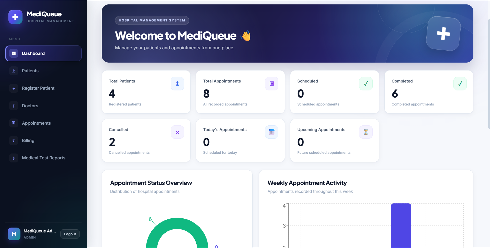
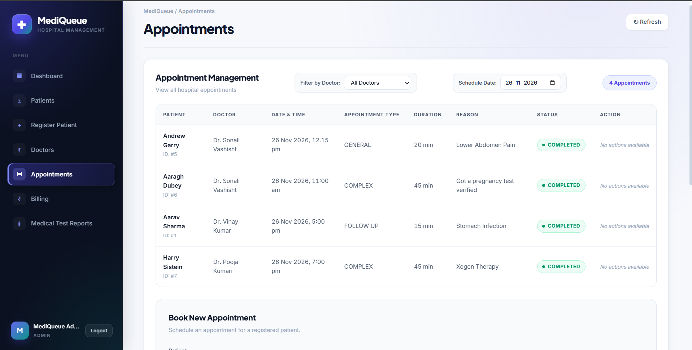
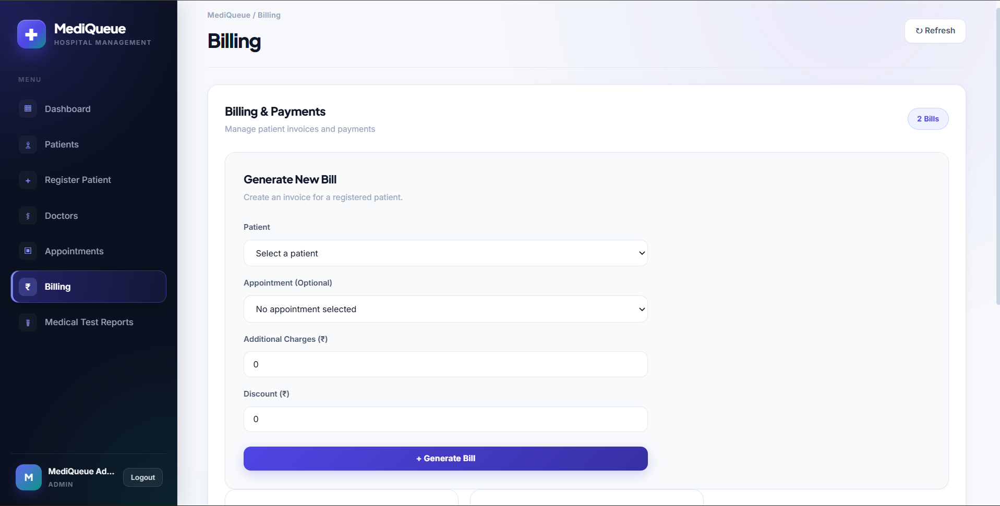
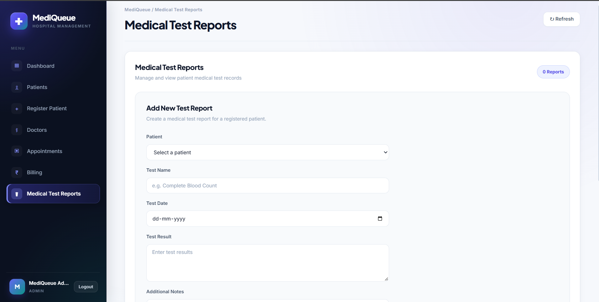
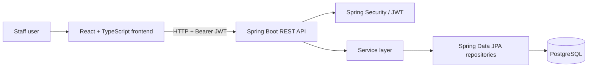

# MediQueue

<div align="center">

### Smart Hospital & Clinic Management Platform

A full-stack clinic management application for organizing patient records, doctor profiles, appointment scheduling, billing, and medical test reports.


</div>

---

## Overview

MediQueue brings common clinic-administration workflows into one web application. Staff can manage patient and doctor records, schedule and track appointments, generate bills, record payments, and maintain medical test reports.

The application is built with a Spring Boot REST API, a React and TypeScript frontend, and PostgreSQL.

## Screenshots

### Dashboard


### Appointment management


### Billing and payments


### Medical test reports


## Features

- **Patient management** — register, search, view, update, and delete patient records.
- **Doctor management** — maintain doctor profiles, specializations, consultation fees, and availability.
- **Appointment scheduling** — select appointment types with estimated durations, check doctor working days and shifts, and reject conflicting scheduled appointments.
- **Appointment tracking** — view appointments and update their status, including completion and cancellation.
- **Dashboard analytics** — review patient and appointment totals, appointment status distribution, and weekly activity.
- **Billing** — generate patient bills, include additional charges and discounts, and associate a bill with an appointment when applicable.
- **Payment tracking** — record payments and track payment status.
- **Printable invoices** — print patient billing information.
- **Medical test reports** — create, view, update, and delete test reports.
- **JWT authentication** — authenticate API requests using signed bearer tokens.
- **Role-aware access** — distinguish ADMIN and RECEPTIONIST accounts and protect administrative operations.

## Technology stack

| Area | Technology |
|---|---|
| Frontend | React 19, TypeScript, Vite |
| UI / charts | CSS, Recharts |
| Backend | Java 21, Spring Boot 4.1.2 |
| API | Spring MVC REST controllers |
| Persistence | Spring Data JPA, Hibernate |
| Database | PostgreSQL |
| Security | Spring Security, JWT, BCrypt password hashing |
| Build | Maven Wrapper, npm |
| Version control | Git, GitHub |

## Architecture



## Repository structure

```text
Mediqueue/
├── backend/
│   ├── src/
│   │   ├── main/
│   │   │   ├── java/com/mediqueue/
│   │   │   │   ├── config/
│   │   │   │   ├── controller/
│   │   │   │   ├── dto/
│   │   │   │   ├── entity/
│   │   │   │   ├── repository/
│   │   │   │   ├── security/
│   │   │   │   └── service/
│   │   │   └── resources/
│   │   └── test/
│   ├── .mvn/
│   ├── mvnw
│   ├── mvnw.cmd
│   ├── Dockerfile
│   └── pom.xml
├── frontend/
│   ├── public/
│   ├── src/
│   └── package.json
├── docs/
│   └── screenshots/
└── README.md
```

## Getting started (Windows / PowerShell)

### Prerequisites

Install the following:

- Java Development Kit (JDK) 21
- Node.js and npm
- PostgreSQL (the project was developed with PostgreSQL 18)
- Git

### 1. Clone the repository

```powershell
git clone https://github.com/harshiig-12/Mediqueue.git
cd Mediqueue
```

### 2. Create the PostgreSQL database

Open PostgreSQL (for example, using `psql` or pgAdmin) and create a database:

```sql
CREATE DATABASE mediqueue_db;
```

Make sure you know the PostgreSQL username and password for your local installation.

### 3. Create the JWT keystore

MediQueue loads an RSA key pair from a PKCS#12 keystore. The keystore must contain a private key with the alias `mediqueue`.

In PowerShell, create a private directory and generate the keystore:

```powershell
New-Item -ItemType Directory -Force "$HOME\.mediqueue"
keytool -genkeypair `
  -alias mediqueue `
  -keyalg RSA `
  -keysize 2048 `
  -storetype PKCS12 `
  -keystore "$HOME\.mediqueue\jwt-keystore.p12" `
  -validity 3650
```

When prompted, set a strong keystore password. Use the same password for the keystore and its key when prompted. Keep the `.p12` file and password private; do not commit either to Git.

### 4. Configure the backend

Copy the example configuration:

```powershell
Copy-Item backend\src\main\resources\application.properties.example `
  backend\src\main\resources\application.properties
```

Open `application.properties` and replace the placeholder values with your local PostgreSQL details and keystore path. The real `application.properties` is intentionally ignored by Git.

The example file documents these properties:

- `spring.datasource.url`
- `spring.datasource.username`
- `spring.datasource.password`
- `mediqueue.jwt.keystore-path`
- `mediqueue.jwt.keystore-password`
- `mediqueue.cors.allowed-origins`

Alternatively, the following PowerShell commands set the environment variables used in the local setup:

```powershell
$env:SPRING_DATASOURCE_URL = "jdbc:postgresql://localhost:5432/mediqueue_db"
$env:SPRING_DATASOURCE_USERNAME = "postgres"
$env:DB_PASSWORD = Read-Host "Enter PostgreSQL password"
$env:JWT_KEYSTORE_PASSWORD = Read-Host "Enter JWT keystore password"
$env:MEDIQUEUE_JWT_KEYSTORE_PATH = "$HOME\.mediqueue\jwt-keystore.p12"
```

If you use the environment-variable approach, ensure the local `application.properties` references those variables. Do not put real passwords in source control.

### 5. Run the backend

Open a PowerShell terminal:

```powershell
cd backend
.\mvnw.cmd spring-boot:run
```

The API starts at:

`http://localhost:8080`

The root health endpoint is:

`http://localhost:8080/`

Expected response: `MediQueue API is running`.

Keep this terminal open while using the application.

### 6. Run the frontend

Open a second PowerShell terminal:

```powershell
cd frontend
npm.cmd install
npm.cmd run dev
```

Vite normally serves the frontend at:

`http://localhost:5173`

Keep this terminal open as well.

### 7. Build and lint the frontend

From the `frontend` directory:

```powershell
npm.cmd run build
npm.cmd run lint
```

## Backend tests

From the `backend` directory, run:

```powershell
.\mvnw.cmd test
```

The repository currently includes a Spring Boot application-context smoke test. Additional focused tests for appointment overlap rules, doctor availability, JWT authentication, and role permissions are recommended as follow-up work; do not interpret the smoke test as coverage of all business rules.

## Authentication and roles

- Registration is public through `POST /api/auth/register`.
- Public registration creates a `RECEPTIONIST` account; it does not allow a user to self-register as `ADMIN`.
- Login is handled through `POST /api/auth/login` and returns a JWT.
- Send the token on protected API requests using the `Authorization: Bearer <token>` header.
- The application uses BCrypt password hashing and an RSA key pair loaded from the local PKCS#12 keystore.

An administrator account must be provisioned through the application's controlled admin setup process. Do not expose administrator credentials or the keystore in the repository.

## Configuration reference

| Property / environment variable | Purpose |
|---|---|
| `SPRING_DATASOURCE_URL` | JDBC URL for PostgreSQL |
| `SPRING_DATASOURCE_USERNAME` | PostgreSQL username |
| `DB_PASSWORD` | PostgreSQL password |
| `MEDIQUEUE_JWT_KEYSTORE_PATH` | Path to the local PKCS#12 keystore |
| `JWT_KEYSTORE_PASSWORD` | Keystore password |
| `CORS_ALLOWED_ORIGINS` | Allowed frontend origin(s) in production |
| `PORT` | Runtime port supplied by a hosting platform when applicable |

For a production deployment, configure secrets through the hosting provider's secret/environment-variable settings. Set `CORS_ALLOWED_ORIGINS` to the exact frontend origin; do not use a wildcard when credentials are enabled.

## Security notes

- Never commit `application.properties`, `.env` files, database passwords, JWT keystores, private keys, or access tokens.
- Keep the keystore outside the repository.
- Use a strong, unique password for the keystore and database.
- Use HTTPS when the frontend and backend are hosted publicly.
- Use synthetic/demo data in screenshots and demonstrations. Do not publish real patient information.

## Project status

MediQueue is a locally runnable portfolio project. It is **not presented as a permanently deployed production service**. A public deployment may be added later when a suitable hosting option is available.

## Future improvements

- Add focused unit and integration tests for scheduling and authorization.
- Split the frontend's main application component into smaller feature components.
- Expand API documentation.
- Add CI checks for backend tests and frontend build/lint.

---

<div align="center">

**Built with Java, Spring Boot, React, TypeScript, and PostgreSQL.**

*MediQueue — Smarter Clinic Management.*

</div>
